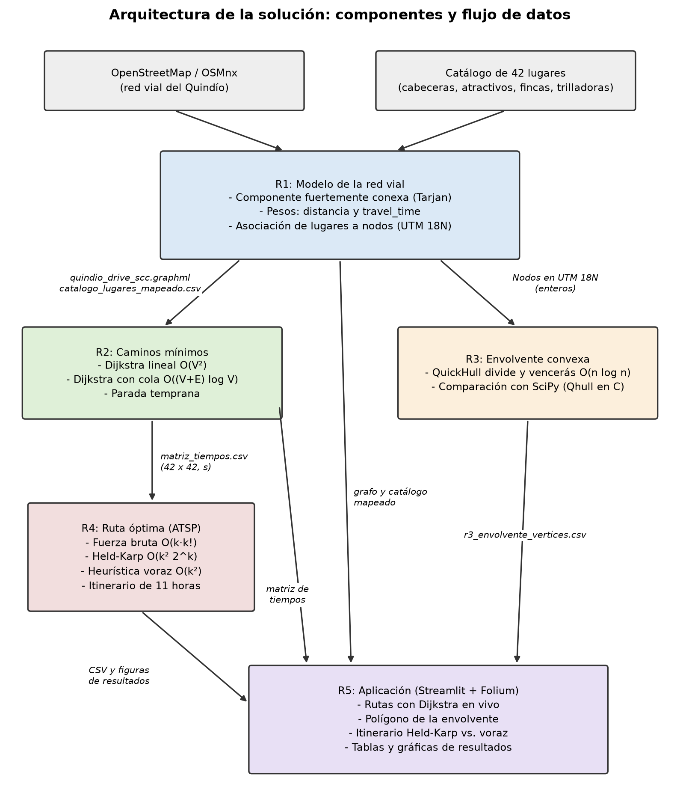
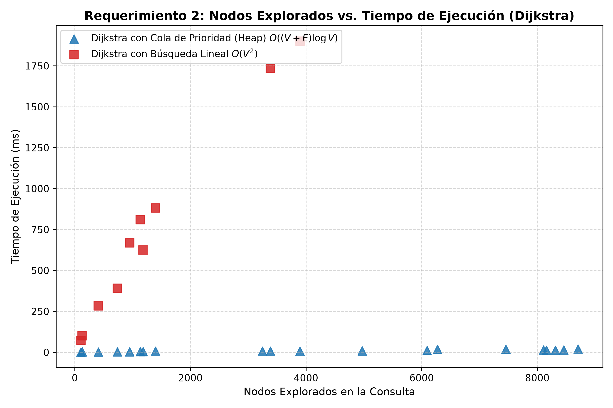
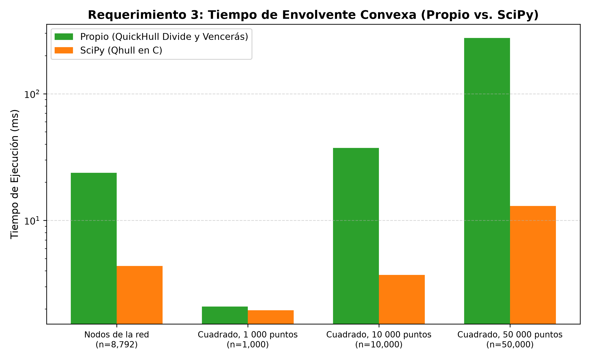
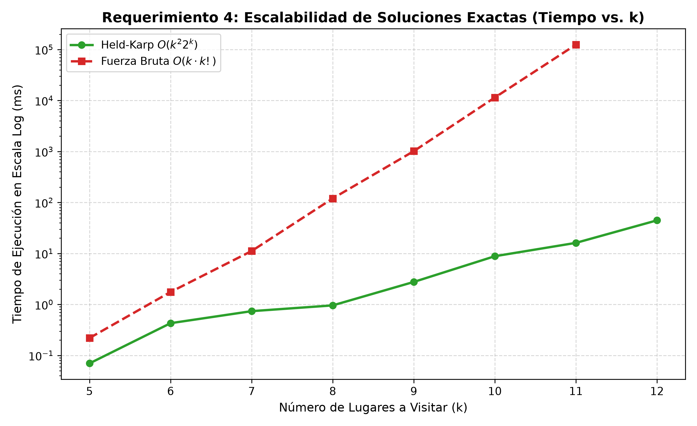
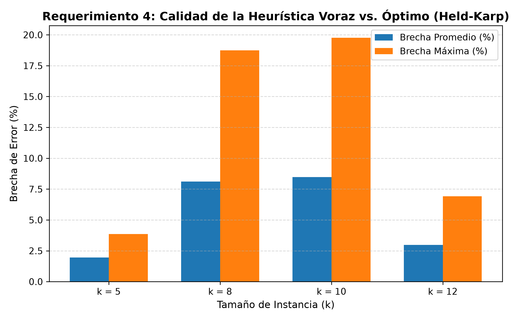

# Informe Técnico: Sistema de Planificación de Rutas sobre la Red Vial del Quindío
## Proyecto Final - Análisis de Algoritmos (2026-2)
**Paisaje Cultural Cafetero de Colombia**

Integrantes: Jacobo Villa Agudelo, Esteban Gómez León y Juan Manuel Peña

---

## 0. Entorno experimental y reproducibilidad

Todas las mediciones de los requerimientos 1 a 4 se hicieron en la misma máquina, siguiendo el protocolo de la sección 6 del enunciado.

| Elemento | Valor |
| :--- | :--- |
| Procesador | 11th Gen Intel(R) Core(TM) i5-1135G7 @ 2.40GHz (2.42 GHz) |
| Memoria RAM | 8,00 GB (7,77 GB utilizable) |
| Sistema operativo | Windows 11 Home Single Language (versión 10.0.26200) |
| Lenguaje | Python 3.13.7 |
| Fecha de descarga de la red | 4 de noviembre de 2026, 17:52:36 (`data/resultados/r1_metadatos.csv`) |

La red del departamento se consultó a Overpass a las 17:48 de ese mismo día. La ejecución que registró la fecha de las 17:52 la leyó de la caché local de OSMnx, porque la primera ejecución se interrumpió cuando el servidor de Overpass respondió que estaba saturado (error 502).

**Versiones de las librerías:**

| Librería | Versión | Uso |
| :--- | :---: | :--- |
| OSMnx | 2.1.1 | Descarga de la red y componente fuertemente conexa (R1) |
| NetworkX | 3.7 | Algoritmo interno de la componente fuertemente conexa (R1) |
| NumPy | 2.5.3 | Generación de puntos aleatorios (R3) |
| SciPy | 1.18.1 | Verificación y comparación de la envolvente convexa (R3) |
| pandas | 3.1.1 | Lectura y escritura de CSV |
| pyproj | 3.8.0 | Proyección a UTM zona 18N (EPSG:32618) |
| GeoPandas | 1.2.0 | Dependencia de OSMnx |
| Shapely | 2.2.0 | Geometrías de las aristas |
| Matplotlib | 3.11.2 | Gráficas |
| Streamlit | 1.66.1 | Aplicación (R5) |
| Folium | 0.20.0 | Mapas de la aplicación (R5) |
| streamlit-folium | 0.27.4 | Mapas de la aplicación (R5) |
| pytest | 9.2.0 | Pruebas automáticas |

**Semillas de los datos aleatorios:**

| Uso | Semilla |
| :--- | :--- |
| R3: puntos al azar en el cuadrado (1 000, 10 000 y 50 000) | `np.random.seed(42)`, fijada una sola vez antes de generar los tres conjuntos |
| R4: lugares de las soluciones exactas para cada $k$ | `random.seed(42 + k)` |
| R4: instancias de la calidad de la heurística | `random.seed(42 + k·100 + instancia)`, con instancia = 1, …, 5 |

**Reglas de medición:**
- Solo se mide el algoritmo, con `time.perf_counter()`. La lectura de archivos, la generación de datos y la impresión quedan por fuera.
- Cada medición se repite 5 veces y se reporta la mediana. Una ejecución de más de un minuto se mide una sola vez.
- Si una ejecución pasa de 5 minutos, se detiene y se reporta como «no completada».
- Todos los tiempos se reportan en **milisegundos (ms)**, salvo que la tabla indique otra unidad.
- Cada tabla y gráfica va acompañada de un párrafo que compara lo medido con lo esperado.
---

## 1. Arquitectura de la Solución y Flujo de Datos

El sistema implementado articula cinco componentes modulares donde los datos fluyen de forma secuencial y estricta:



*Figura: componentes de la solución y archivos que pasan de un requerimiento a otro. Se genera con `experiments/generate_charts.py`; la versión en Mermaid está en `docs/figuras/arquitectura.mmd`.*

---

## 2. Requerimiento 1: Modelo de la Red Vial

### 2.1. Problema y Representación en Memoria
La red vial para conducción (`network_type="drive"`) del departamento se descargó con `ox.graph_from_place("Quindío, Colombia", network_type="drive")` el 4 de noviembre de 2026. Su tamaño, antes y después de quedarse con la componente fuertemente conexa más grande (`data/resultados/r1_tamano_red.csv`):

| Red | Nodos | Aristas |
| :--- | :---: | :---: |
| Red descargada | 8 808 | 20 157 |
| Componente fuertemente conexa | 8 792 | 20 136 |

La componente conserva el 99,8 % de los nodos y el 99,9 % de las aristas: se descartan 16 nodos y 21 aristas.

#### Estimación Analítica de Memoria
Se usan los valores de la red descargada: $V = 8\,808$ y $E = 20\,157$. 1 MB = $1024^2$ bytes.

1. **Matriz de Adyacencia:**
   - Supuesto: matriz de $V \times V$ celdas, cada una con un flotante de doble precisión (8 bytes) para el peso.
   $$\text{Bytes} = V^2 \times 8 = 8\,808^2 \times 8 = 620\,646\,912 \text{ bytes} \approx \mathbf{591.90\text{ MB}}$$
2. **Listas de Adyacencia:**
   - Supuesto: un arreglo de $V$ punteros de cabecera (8 bytes cada uno). Cada arista ocupa una entrada con el identificador del destino (8 bytes), el peso en flotante (8 bytes) y el puntero al siguiente elemento (8 bytes), es decir, 24 bytes por arista.
   $$\text{Bytes} = (V \times 8) + (E \times 24) = (8\,808 \times 8) + (20\,157 \times 24) = 554\,232 \text{ bytes} \approx \mathbf{0.53\text{ MB}}$$

> **Justificación de la elección:** La matriz de adyacencia ocuparía **unas 1 120 veces más memoria** que las listas de adyacencia (620 646 912 / 554 232 ≈ 1 119,8). La red vial es muy dispersa: el grado promedio de salida es $E/V \approx 2{,}29 \ll V$. Por eso el 99,97 % de las celdas de la matriz quedaría vacío, guardando «infinito». Se eligieron las **listas de adyacencia**, implementadas como un diccionario de Python que asocia cada nodo con la lista de sus pares (vecino, tiempo de viaje). Así se recorren los vecinos de $u$ en tiempo $O(\deg(u))$.

### 2.2. Asignación de Pesos (Distancia y Tiempo de Viaje)
Cada arista guarda su distancia `length` (m), su velocidad `speed_kph` (km/h) y su tiempo de viaje `travel_time` (s) (`src/r1_network/weights.py`).

- **Distancia:** el atributo `length` que OSMnx calcula para cada tramo, en metros.
- **Velocidad desde OSM:** se usa el atributo `maxspeed` cuando existe. Si es texto, se toma el primer número (por ejemplo, «60 km/h» → 60). Si el tramo trae una lista de valores, se usa su promedio. Los valores menores o iguales a 5 km/h se descartan y se tratan como tramo sin velocidad.
- **Cobertura de `maxspeed`:** en la componente fuertemente conexa, solo **1 303 de las 20 136 aristas (6,47 %)** tienen `maxspeed`. El valor más común es 30 km/h (977 aristas), seguido de 40 km/h (127), 60 km/h (75), 50 km/h (55) y 20 km/h (46). El 93,53 % restante usa una velocidad imputada.
- **Velocidad imputada:** para los tramos sin `maxspeed`, la velocidad se asigna según el tipo de vía (`highway`), con el diccionario `DEFAULT_SPEEDS_KMH`. Son valores definidos por el grupo según la jerarquía vial de OpenStreetMap:

| Tipo de vía (`highway`) | Velocidad imputada (km/h) | Aristas de la componente sin `maxspeed` |
| :--- | :---: | :---: |
| `motorway` | 80 | 0 |
| `motorway_link` | 60 | 0 |
| `trunk` | 70 | 298 |
| `trunk_link` | 50 | 36 |
| `primary` | 60 | 397 |
| `primary_link` | 45 | 36 |
| `secondary` | 45 | 1 124 |
| `secondary_link` | 35 | 44 |
| `tertiary` | 35 | 1 521 |
| `tertiary_link` | 25 | 5 |
| `residential` | 25 | 13 152 |
| `unclassified` | 25 | 2 149 |
| `living_street` | 15 | 0 |
| `service` | 20 | 0 |
| `track` | 15 | 0 |
| Cualquier otro tipo (valor por defecto) | 25 | 4 (`ladder`) |

  Cuando una arista tiene una lista de tipos de vía, se usa el primero; esto ocurre en 67 aristas sin `maxspeed`, por ejemplo `['residential', 'unclassified']`. Los tipos `service` y `track` aparecen en el diccionario pero no en la red: el filtro `drive` de OSMnx excluye las vías de servicio (documentación de `osmnx._overpass._get_network_filter`, versión 2.1.1). Tampoco hay `motorway` ni `living_street` en la componente.
- **Tiempo de viaje:** el peso de cada arista para los caminos mínimos es el tiempo de viaje, en segundos:
  $$t = \frac{d}{v / 3.6}$$
  donde $d$ es la distancia en metros y $v$ la velocidad en km/h. Por seguridad, la velocidad mínima es 0,5 m/s, para no dividir por cero.

> **Importante:** este tiempo es una **estimación del modelo**, no el tiempo real de recorrido. Supone que cada tramo se recorre a velocidad constante igual a su límite o a la velocidad imputada, y no considera semáforos, giros, pendientes, estado de la vía ni tráfico.

### 2.3. Componente Fuertemente Conexa (SCC)
Una componente fuertemente conexa es un conjunto de nodos en el que, respetando el sentido de las vías, se puede ir de cualquiera a cualquier otro. Se obtiene con `ox.truncate.largest_component(G, strongly=True)`.

**Qué hace la función** (código fuente de `osmnx/truncate.py`, OSMnx 2.1.1):
1. **Comprueba la conexidad** con `nx.is_strongly_connected(G)`. Esta función genera la primera componente con `strongly_connected_components` y la compara con el número total de nodos.
2. **Elige la mayor componente**, si el grafo no es fuertemente conexo, con `max(nx.strongly_connected_components(G), key=len)`.
3. **Copia el subgrafo:** crea un grafo nuevo inducido por esa componente con `nx.MultiDiGraph(G.subgraph(largest_cc))`, que copia los nodos, las aristas y todos sus atributos.

Los tres pasos quedan dentro del tiempo medido. En las cinco redes medidas el grafo no era fuertemente conexo, así que siempre se ejecutaron los tres.

**Algoritmo interno** (código fuente de `networkx/algorithms/components/strongly_connected.py`, NetworkX 3.7): `strongly_connected_components` implementa una **versión iterativa del algoritmo de Tarjan**. La documentación de la función dice que incorpora las mejoras descritas por Tarjan y Zwick (2024, *Finding strong components using depth-first search*, European Journal of Combinatorics 119) y un truco tomado de la implementación en Rust de WebGraph (Fontana, Vigna y Zacchiroli, 2024).

El algoritmo hace una búsqueda en profundidad (DFS) con una pila explícita en lugar de recursión. A cada nodo le asigna un número de orden de descubrimiento y un valor `lowlink`, el menor número de orden alcanzable desde su subárbol por aristas de retroceso o cruce hacia nodos que aún no tienen componente asignada. Cuando, al terminar de explorar un nodo, su `lowlink` es igual a su propio número de orden, ese nodo es la raíz de una componente. Entonces se sacan de la pila de componentes todos los nodos que la forman.

**Complejidad** (Tarjan, R. E., 1972, «Depth-first search and linear graph algorithms», *SIAM Journal on Computing* 1(2), 146–160):
- **Tiempo:** $O(V + E)$. Cada nodo se descubre una vez y cada arista se examina una vez.
- **Memoria:** $O(V)$ adicional, para el diccionario `lowlink`, el conjunto de nodos ya asignados y las pilas.

Los otros dos pasos de `largest_component` no cambian el orden del tiempo. Elegir la mayor componente es $O(V)$. Copiar el subgrafo es $O(V + E)$ en tiempo, y el grafo copiado ocupa $O(V + E)$ en memoria, porque es el resultado que devuelve la función.

#### Resultados Experimentales de SCC
Tiempo de `ox.truncate.largest_component(G, strongly=True)`, en **milisegundos**, mediana de 5 repeticiones (`data/resultados/r1_tiempos_scc.csv`). Las redes por radio se descargaron con `ox.graph_from_point((4.534322755439026, -75.67278722933959), dist=r, network_type="drive")` alrededor de la plaza de Bolívar de Armenia. La descarga no se incluye en el tiempo medido. La última columna se calculó a partir de las anteriores.

| Red | $V$ | $E$ | $V + E$ | Tiempo (ms) | Tiempo por elemento (µs) |
| :--- | :---: | :---: | :---: | :---: | :---: |
| Radio de 2 km | 1 659 | 3 697 | 5 356 | 37,69 | 7,04 |
| Radio de 5 km | 4 297 | 9 710 | 14 007 | 115,08 | 8,22 |
| Radio de 10 km | 6 036 | 13 628 | 19 664 | 148,39 | 7,55 |
| Radio de 20 km | 8 774 | 20 046 | 28 820 | 327,32 | 11,36 |
| Departamento completo | 8 808 | 20 157 | 28 965 | 386,32 | 13,34 |

**Discusión:** el tiempo crece con $V + E$, como predice la complejidad $O(V + E)$, pero el ajuste lineal no es perfecto. La recta de mínimos cuadrados con los cinco puntos es $t \approx 14{,}03 \cdot \frac{V+E}{1000} - 68{,}75$ ms, con **$R^2 = 0{,}919$**. Los puntos que se salen de la tendencia son:

- **Radio de 20 km y departamento completo.** Tardan entre 11,4 y 13,3 µs por elemento, frente a 7,0–8,2 µs de las redes pequeñas. Además, estas dos redes tienen casi el mismo tamaño (28 820 y 28 965 elementos, apenas un 0,5 % de diferencia), pero sus tiempos difieren en 59 ms (un 18 %).
- **Radio de 10 km.** Queda por debajo de la recta, porque la recta se inclina hacia los dos puntos anteriores.

#### Diagnóstico: tiempo de cada paso de `largest_component`
Para entender la desviación se ejecutó un diagnóstico aparte, `experiments/run_r1_fases_scc.py`, que guarda sus resultados en `data/resultados/r1_fases_scc.csv`. Mide por separado cada paso de la función sobre las mismas cinco redes, que se leyeron de la caché de OSMnx (las mismas respuestas de Overpass del pipeline). Se hizo en la misma máquina, con 5 repeticiones y mediana, y con la copia del grafo fuera del cronómetro. Tiempos en **milisegundos**:

| Red | $V + E$ | `is_strongly_connected` (ms) | Componentes + `max` (ms) | Copia del subgrafo (ms) | Total `largest_component` (ms) | Total por elemento (µs) |
| :--- | :---: | :---: | :---: | :---: | :---: | :---: |
| Radio de 2 km | 5 356 | 0,22 | 2,23 | 33,40 | 37,94 | 7,08 |
| Radio de 5 km | 14 007 | 0,58 | 6,41 | 96,46 | 104,52 | 7,46 |
| Radio de 10 km | 19 664 | 1,44 | 9,12 | 137,27 | 153,80 | 7,82 |
| Radio de 20 km | 28 820 | 1,33 | 14,46 | 195,67 | 212,44 | 7,37 |
| Departamento completo | 28 965 | 1,30 | 12,98 | 201,06 | 207,65 | 7,17 |

Cada columna se midió en una ejecución aparte, por eso las columnas no suman exactamente el total. La última columna se calculó a partir de las anteriores. En las cinco redes el grafo no era fuertemente conexo (columna `Fuertemente conexa` del CSV), así que la función siempre ejecutó los tres pasos.

**Discusión del diagnóstico:**
1. **El algoritmo de Tarjan es una parte pequeña del tiempo.** La comprobación de conexidad más el cálculo de componentes suman entre 2,45 y 15,79 ms. Entre el **88 % y el 97 %** del tiempo de `largest_component` se va en **copiar el subgrafo**, que crea de nuevo cada nodo y cada arista con sus diccionarios de atributos. Ese paso también es lineal en $V + E$: su ajuste lineal da $R^2 = 0{,}999$.
2. **En esta ejecución el tiempo total sí es lineal.** El total se ajusta a la recta $t \approx 7{,}28 \cdot \frac{V+E}{1000} + 2{,}39$ ms con **$R^2 = 0{,}995$**. El costo por elemento es casi constante (entre 7,08 y 7,82 µs) en todas las redes, incluidas las de 20 km y el departamento, que ahora tardan casi lo mismo (212,44 y 207,65 ms), como corresponde a su tamaño casi igual.
3. **Hay variación entre ejecuciones.** Las mismas redes tardaron 327,32 ms (20 km) y 386,32 ms (departamento) en el pipeline, frente a 212,44 y 207,65 ms en el diagnóstico. Las redes pequeñas, en cambio, dieron tiempos parecidos (37,69 frente a 37,94 ms en la de 2 km).

**Conclusión:** la desviación de la tabla principal ($R^2 = 0{,}919$) viene de que los dos últimos puntos del pipeline se midieron más lentos. No es que el algoritmo cueste más por elemento en las redes grandes: al repetir la medición, el costo por elemento fue constante y el ajuste lineal casi perfecto ($R^2 = 0{,}995$). Ambas mediciones son compatibles con la complejidad $O(V + E)$. No se identificó la causa de que esos dos puntos salieran más lentos en el pipeline, por ejemplo otra actividad del sistema durante la medición. Por eso se reportan las dos mediciones tal como salieron.

**Por qué se trabaja solo con la componente:** en la componente fuertemente conexa existe un camino dirigido entre cualquier par de nodos. Así:
- Dijkstra (R2) siempre encuentra una ruta entre dos lugares del catálogo.
- La matriz de tiempos no tiene valores infinitos: se comprobó que los 42 × 42 valores son finitos.
- Los recorridos de R4 siempre pueden cerrarse regresando al lugar de partida.

Si se trabajara con la red completa, un lugar asociado a un nodo de una componente pequeña, como el final de una vía de un solo sentido, podría quedar sin ruta de ida o de regreso. Filtrar la componente solo cuesta 16 nodos y 21 aristas.

### 2.4. Ubicación de Lugares y Matching Espacial
**Verificación de coordenadas:** las coordenadas de los 42 lugares del catálogo (`data/catalogo_lugares.csv`) se verificaron una a una en Google Maps. La excepción es Finca Villa Nora (id 32), cuyas coordenadas se tomaron del mapa de Hoteles.com, como indica la columna `fuente_justificacion` del catálogo. Las cabeceras municipales se ubican en su plaza o parque principal.

**Asociación a nodos:** cada lugar y cada nodo de la componente se proyectaron a **UTM zona 18N (EPSG:32618)**. Luego cada lugar se asoció al nodo con menor distancia euclidiana en metros (`map_places_to_nodes` en `src/r1_network/downloader.py`). El resultado está en `data/catalogo_lugares_mapeado.csv`, columnas `nearest_node_id` y `distance_to_node_m`.

- **38 lugares** quedaron a menos de 500 m de su nodo.
- **4 lugares** quedaron a más de 500 m:

| id | Lugar | Municipio | Categoría | Distancia al nodo (m) | Tipo de vía del nodo |
| :---: | :--- | :--- | :--- | :---: | :--- |
| 15 | Valle de Cocora | Salento | Atractivo turístico | 997,93 | `unclassified` |
| 29 | Hotel Hacienda Combia | Calarcá | Finca cafetera u hotel rural | 727,10 | `unclassified` |
| 18 | Recuca - Recorrido de la Cultura Cafetera | Calarcá | Atractivo turístico | 550,11 | `residential` |
| 35 | Reserva El Cairo | Salento | Finca cafetera u hotel rural | 508,29 | `residential` |

**Tratamiento:** en los cuatro casos se **mantuvo la asociación al nodo más cercano de la componente**. No se movieron las coordenadas, que ya estaban verificadas, ni se agregaron nodos o aristas. Ese nodo es el punto de la red de conducción más cercano al lugar y se usa como origen o destino de sus rutas. El tramo entre el nodo y el lugar (entre 508 y 998 m en línea recta) **no se suma** al tiempo de viaje, así que para estos lugares el tiempo del modelo subestima el acceso final. Una explicación posible de la distancia es que el último tramo de acceso no forma parte de la red de conducción: el filtro `drive` de OSMnx excluye las vías de servicio y los caminos peatonales, o el tramo puede no estar mapeado en OpenStreetMap. Esto no se verificó lugar por lugar.

**Nodos compartidos:** los 42 lugares quedaron asociados a **42 nodos distintos**; ningún par de lugares comparte nodo. Por eso no hay tiempos de viaje iguales a 0 fuera de la diagonal de la matriz de tiempos: el menor tiempo entre dos lugares distintos es 5,2 s.

**Duración de las visitas:** la duración de cada atractivo turístico (columna `duracion_visita_min`, entre 45 y 360 min) sigue un **criterio definido por el grupo**: la estimación de una visita típica a ese lugar. La columna `fuente_justificacion` describe en qué consiste esa visita, por ejemplo «recorrido completo de las atracciones» en el Parque Nacional del Café (360 min) o «ascenso a la torre mirador y fotografías» en el Mirador Colina Iluminada (60 min). Estas duraciones no provienen de una fuente externa y se usan en el itinerario de R4.

---

## 3. Requerimiento 2: Caminos Mínimos (Dijkstra)

### 3.1. Algoritmos Implementados desde Cero
Ambas versiones trabajan sobre la componente fuertemente conexa de R1 ($V = 8\,792$, $E = 20\,136$), con el tiempo de viaje en segundos como peso. Reciben la lista de adyacencia `adj_list[u] = [(v, t), ...]` y devuelven el tiempo, la ruta reconstruida desde los predecesores y el número de nodos explorados. Ambas se detienen al sacar el destino, y cada nodo se cuenta como explorado una sola vez, la primera vez que sale. Cuando hay aristas paralelas entre dos nodos, se conserva la de menor tiempo (`osmnx_to_clean_adj_list`).

1. **Dijkstra con búsqueda lineal** (`src/r2_paths/dijkstra_linear.py`). Guarda los nodos pendientes en un conjunto (`set`). En cada iteración recorre todo ese conjunto para encontrar el de menor distancia, lo saca y relaja sus aristas.
   - **Tiempo: $O(V^2)$.** Hay a lo sumo $V$ extracciones y cada una recorre hasta $V$ nodos pendientes, $O(V^2)$ en total. Cada arista se relaja una vez, $O(E)$, y como $E \le V^2$ el total es $O(V^2 + E) = O(V^2)$.
   - **Memoria: $O(V)$** adicional a la lista de adyacencia, por los diccionarios `dist` y `predecessors` y el conjunto de pendientes.
   - Si se detiene después de explorar $k$ nodos, el costo es $O(k \cdot V)$.
   - **Fuente:** Dijkstra, E. W. (1959). «A note on two problems in connexion with graphs». *Numerische Mathematik*, 1, 269–271. Es la versión original del algoritmo, que busca el mínimo recorriendo los nodos.

2. **Dijkstra con cola de prioridad** (`src/r2_paths/dijkstra_heap.py`). Usa un montículo binario mínimo (`heapq`) de pares (distancia, nodo). En lugar de la operación de disminuir clave, cada relajación exitosa inserta una entrada nueva. Al sacar una entrada de un nodo ya explorado, se descarta (inserción perezosa).
   - **Tiempo: $O((V + E) \log V)$.** Hay a lo sumo $E + 1$ inserciones y otras tantas extracciones, cada una en $O(\log(E+1))$. Como $E \le V^2$, $\log E \le 2 \log V$, así que $O(E \log E) = O(E \log V)$. A esto se suma $O(V)$ para inicializar `dist` y `predecessors` con todos los nodos.
   - **Memoria: $O(V + E)$.** `dist`, `predecessors` y el conjunto de visitados ocupan $O(V)$. El montículo puede guardar hasta una entrada por relajación exitosa, $O(E)$.
   - **Fuente:** Cormen, T. H., Leiserson, C. E., Rivest, R. L. y Stein, C. *Introduction to Algorithms*. MIT Press. Dijkstra con montículo binario: 3.ª ed. (2009), capítulo 24, «Single-Source Shortest Paths», sección 24.3; en la 4.ª ed. (2022) es el capítulo 22, sección 22.3.

**Costo de las estructuras de apoyo:**
- **`heapq.heappop`:** la documentación de Python (módulo `heapq`, sección *Theory*) explica que sacar la raíz y restablecer la propiedad del montículo es «logarítmico en el número total de elementos del árbol», $O(\log n)$.
- **`heapq.heappush`:** esa documentación no da un costo explícito. Agrega el elemento al final de la lista y lo sube por el camino hasta la raíz (función `_siftdown` en `Lib/heapq.py`, el código de referencia de CPython). Ese camino mide a lo sumo la altura del árbol, así que cuesta $O(\log n)$, como `MIN-HEAP-INSERT` en Cormen et al., capítulo 6.
- **`dict` y `set`:** según la documentación oficial de Python, «Time complexity of operations on built-in types», en CPython leer, asignar y borrar en un `dict`, y probar pertenencia (`x in s`), agregar y descartar en un `set`, cuestan $O(1)$ en el caso promedio. El caso promedio supone que las funciones hash generan pocas colisiones; en el peor caso, cuando todas las claves colisionan, cada operación pasa a $O(n)$. Las claves son identificadores enteros de nodos de OSM, así que se usa el costo promedio $O(1)$.

### 3.2. Invariante y Argumento de Correctitud
- **Enunciado del Invariante:** Al inicio de cada iteración del bucle principal, para cada nodo $u \in S$ (conjunto de nodos explorados/cerrados), la distancia calculada `dist[u]` es igual a la distancia del camino más corto $\delta(s, u)$ desde el origen $s$.
- **Por qué permite detenerse al sacar el destino:** Sea $t$ el nodo destino. Cuando $t$ es extraído de la cola de prioridad (o del conjunto no visitado), su distancia es $dist[t] = \min_{v \notin S} \{ dist[v] \}$. Como todos los pesos de las aristas son no negativos ($w(u, v) \ge 0$), cualquier camino alternativo hacia $t$ que pase por algún nodo aún no explorado $v \notin S$ tendrá una longitud de al menos $dist[v] + w(v, \dots) \ge dist[v] \ge dist[t]$. Por ende, ninguna relajación futura podrá reducir la distancia a $t$, garantizando que $dist[t] = \delta(s, t)$ en el momento de la extracción.
- **Condición requerida:** No negatividad de los pesos ($w \ge 0$). Con pesos negativos, un camino más largo en nodos podría reducir el costo total posterior, invalidando la elección voraz.

### 3.3. Verificación
Lo que hace el código para verificar las dos versiones:
1. **Comparación entre versiones en los pares medidos.** En `experiments/run_r2_pipeline.py`, para cada uno de los 10 pares medidos con ambas versiones se comprueba `abs(cost_h - cost_l) < 1e-4`. Si los tiempos de viaje difieren, el programa se detiene con un error. En la ejecución reportada pasó en los 10 pares. En `r2_mediciones_dijkstra.csv` las dos versiones dan además el mismo número de nodos explorados en los 10 pares. El código no compara las rutas (las secuencias de nodos) en estos pares, solo el tiempo.
2. **Caso pequeño resuelto a mano** (`tests/test_dijkstra.py`, ejecutado con `pytest`). Se usa un grafo dirigido de 6 nodos y se comprueba:
   - Las dos versiones dan el camino mínimo de 0 a 4, con costo 7 y ruta [0, 2, 3, 4].
   - Las dos devuelven infinito y ruta vacía hacia un nodo inalcanzable.
   - Las dos devuelven costo 0 y ruta [2] cuando origen y destino coinciden.
   - `dijkstra_all_destinations`, la versión sin parada temprana que se usa para la matriz, da las distancias esperadas a todos los nodos.

   Las 4 pruebas pasan.

### 3.4. Resultados Experimentales de Dijkstra
Se midieron 20 pares origen-destino del catálogo con la versión con cola de prioridad. De ellos, 10 pares **cercanos** (del mismo municipio o de municipios vecinos) se midieron también con la versión lineal. Cada medición es la mediana de 5 repeticiones. Los datos completos están en `data/resultados/r2_mediciones_dijkstra.csv`, con columnas `origen, destino, version, tiempo_viaje_s, nodos_explorados, tiempo_ms`.

**Pares medidos con ambas versiones** (tiempos de ejecución en **milisegundos**; tiempo de viaje en **segundos**). El cociente de cada fila se calculó con los tiempos redondeados del CSV.

| Origen → Destino | Tiempo de viaje (s) | Nodos explorados | Cola de prioridad (ms) | Lineal (ms) | Cociente lineal / cola |
| :--- | :---: | :---: | :---: | :---: | :---: |
| Plaza de Bolívar Armenia → Parque de la Vida | 208,96 | 1 135 | 3,72 | 809,83 | 217,7 |
| Plaza de Bolívar Armenia → Museo del Oro Quimbaya | 523,32 | 3 896 | 6,86 | 1 900,71 | 277,1 |
| Plaza de Bolívar Armenia → Cooperativa de Caficultores - Armenia | 214,59 | 1 180 | 4,79 | 625,05 | 130,5 |
| Plaza Mayor de Calarcá → Jardín Botánico del Quindío | 297,42 | 739 | 2,94 | 390,61 | 132,9 |
| Plaza Mayor de Calarcá → Ecoparque Peñas Blancas | 683,57 | 3 384 | 6,54 | 1 733,36 | 265,0 |
| Plaza de Bolívar de Salento → Valle de Cocora | 1 701,61 | 1 397 | 6,68 | 880,92 | 131,9 |
| Plaza de Bolívar de Salento → Las Acacias Coffee Farm | 382,16 | 106 | 2,12 | 71,53 | 33,7 |
| Parque Principal de Montenegro → Parque Nacional del Café | 333,53 | 407 | 2,19 | 284,44 | 129,9 |
| Plaza de Bolívar de Quimbaya → PANACA | 939,21 | 948 | 3,07 | 668,72 | 217,8 |
| Parque Principal de Filandia → Mirador Colina Iluminada | 87,73 | 129 | 2,34 | 101,18 | 43,2 |

Los otros 10 pares, medidos solo con cola de prioridad, son de media y larga distancia entre municipios. Exploraron entre 3 245 y 8 703 nodos y tardaron entre 7,16 y 19,50 ms.

**Cociente entre versiones** en los 10 pares medidos con ambas (`data/resultados/r2_cociente_versiones.csv`). Se calcula con `statistics.median`, que con 10 valores promedia los dos centrales:

| Mediana | Mínimo | Máximo |
| :---: | :---: | :---: |
| 132,3 | 33,72 | 277,18 |



*Gráfica: nodos explorados (eje horizontal) frente a tiempo de ejecución en milisegundos (eje vertical); triángulos para la versión con cola de prioridad y cuadrados para la versión lineal.*

**Discusión:** lo medido coincide con lo esperado.
- **Versión lineal.** Cuando explora $k$ nodos, cada extracción recorre los nodos pendientes, que son casi todos los $V = 8\,792$. Su costo esperado es entonces proporcional a $k \cdot V$. Al dividir cada tiempo medido entre el número aproximado de nodos recorridos, $k \cdot (V - k/2)$, se obtiene un costo casi constante, entre 63 y 90 ns por nodo recorrido en los 10 pares. Esto confirma el comportamiento $O(k \cdot V)$, que llega a $O(V^2)$ si se exploran todos los nodos.
- **Versión con cola de prioridad.** El tiempo crece mucho más despacio. Los 20 pares tardaron entre 2,12 y 19,50 ms, incluso cuando se exploraron 8 703 de los 8 792 nodos. Las consultas que exploran muy pocos nodos (106 y 129) tardan algo más de 2 ms, porque la función inicializa `dist` y `predecessors` con todos los nodos del grafo, un costo fijo $O(V)$ por consulta que no depende de cuántos nodos se exploren.
- **El cociente crece con los nodos explorados** (correlación de 0,84 en los 10 pares). Va de 33,7 cuando se exploran 106 nodos a 277,1 cuando se exploran 3 896. En consultas cortas pesa el costo fijo de inicializar la versión con cola. En consultas más largas domina el recorrido $O(V)$ de la versión lineal en cada extracción.

**Matriz de tiempos:** `data/matriz_tiempos.csv` tiene 42 × 42 valores en **segundos**. La primera fila y la primera columna son los identificadores de los lugares, y la celda $(i, j)$ es el tiempo de ir de $i$ a $j$. Se calculó con `dijkstra_all_destinations` (cola de prioridad, sin parada temprana), ejecutado una vez desde cada lugar. Todos los valores son finitos. La matriz no es simétrica: en 850 de los 861 pares de lugares, el tiempo de ida difiere del de regreso en más de 0,01 s, por los sentidos de las vías.

---

## 4. Requerimiento 3: Envolvente Convexa de la Red Vial

### 4.1. Algoritmo Divide y Vencerás (QuickHull)
Implementación propia en `src/r3_geometry/convex_hull_dandc.py`.

- **Coordenadas:** los nodos de la componente se proyectan a UTM zona 18N (EPSG:32618), cada coordenada se redondea al entero más cercano y se eliminan los puntos repetidos. Python usa enteros de precisión arbitraria, así que los productos cruz no se desbordan. Para SciPy los puntos se pasan como arreglo `int64`. Los giros y alineaciones se calculan con el producto cruz entero:
  $$\text{cross}(p_1, p_2, p_3) = (x_2 - x_1)(y_3 - y_1) - (y_2 - y_1)(x_3 - x_1)$$
  Es positivo si $p_3$ queda a la izquierda de $p_1 \to p_2$, negativo si queda a la derecha y 0 si los tres puntos son colineales.
- **Estrategia de divide y vencerás:**
  - *Dividir:* se toman los puntos de menor y mayor abscisa, $A$ y $B$, que siempre son vértices. La recta $AB$ separa los puntos en dos subconjuntos, los que quedan estrictamente a cada lado.
  - *Vencer:* en cada subconjunto se busca el punto $C$ más lejano a la recta, que es el de mayor producto cruz. En caso de empate se elige el más lejano a $A$. Los puntos dentro del triángulo $ABC$ se descartan. Los que quedan estrictamente fuera de $AC$ y de $CB$ forman dos subproblemas que se resuelven recursivamente.
  - *Combinar:* se concatenan los vértices de los subproblemas en orden de recorrido del perímetro.
- **Puntos alineados:** solo pasan a un subproblema los puntos con producto cruz estrictamente positivo. Así, los puntos alineados sobre un lado del polígono no se cuentan como vértices.

**Por qué QuickHull para esta red:** el costo de QuickHull depende de cuántos puntos quedan fuera de los triángulos en cada paso. Es eficiente cuando la mayoría de los puntos son interiores y la envolvente tiene pocos vértices. Los nodos de la red cumplen eso:
- De 8 792 puntos, solo **14** son vértices de la envolvente.
- Los nodos se concentran en las cabeceras municipales y a lo largo de las vías, dentro del territorio del departamento, y pocos quedan cerca del borde.

Por eso los primeros triángulos descartan la mayor parte de los puntos y los subproblemas que quedan son pequeños. Un algoritmo de divide y vencerás que primero ordena todos los puntos y luego mezcla envolventes paga siempre $O(n \log n)$, aunque la envolvente tenga pocos vértices.

### 4.2. Recurrencia y Análisis Teórico
Si $n_1$ y $n_2$ son los puntos que quedan fuera de los lados $AC$ y $CB$ (con $n_1 + n_2 \le n - 1$), cada llamada recorre sus $n$ puntos para encontrar $C$ y repartirlos:
$$T(n) = T(n_1) + T(n_2) + O(n)$$
- **Caso promedio, $O(n \log n)$:** las divisiones son razonablemente balanceadas. Si $n_1 \approx n_2 \approx n/2$, la recurrencia queda $T(n) = 2T(n/2) + O(n)$. Por el teorema maestro ($a = 2$, $b = 2$, $f(n) = \Theta(n)$, caso 2), da $T(n) = \Theta(n \log n)$.
- **Peor caso, $O(n^2)$:** cada división queda muy desbalanceada. Por ejemplo, cuando casi todos los puntos son vértices de la envolvente y el punto más lejano queda cada vez junto a un extremo, de modo que un lado recibe casi todos los puntos y el otro ninguno. Entonces $T(n) = T(n-1) + O(n) = O(n^2)$. Los puntos sobre un círculo **no** son el peor caso: el punto más lejano a una cuerda es el punto medio del arco, que divide los puntos en dos mitades iguales.
- **Memoria, $O(n)$:** los puntos sin repetir y las listas de cada subproblema. En el caso balanceado, las listas vivas a lo largo de la recursión suman $O(n)$. En esta implementación, la lista de cada nivel permanece en memoria mientras se resuelven sus subproblemas, así que en el peor caso desbalanceado esa suma podría crecer más; esto no se midió.
- **Estructuras de apoyo:** eliminar los puntos repetidos con un `set` cuesta $O(n)$ en el caso promedio, porque agregar y probar pertenencia son $O(1)$ según la documentación oficial de Python, «Time complexity of operations on built-in types». Buscar los extremos con `min` y `max` también es $O(n)$. No se ordena ningún conjunto de puntos, así que no hay un costo $O(n \log n)$ de ordenamiento.
- **Fuente:** Barber, C. B., Dobkin, D. P. y Huhdanpaa, H. (1996). «The Quickhull algorithm for convex hulls». *ACM Transactions on Mathematical Software*, 22(4), 469–483.

### 4.3. Verificación
- **Contra SciPy en cada conjunto medido.** `experiments/run_r3_pipeline.py` calcula la envolvente con `scipy.spatial.ConvexHull` sobre los mismos puntos enteros. Luego compara el conjunto de vértices de SciPy (`hull.vertices`) con el conjunto de vértices propio. **Si no son iguales, el programa lanza un `RuntimeError` y se detiene**; antes solo imprimía una advertencia. En la ejecución reportada coincidieron en los 4 conjuntos: 14, 17, 25 y 36 vértices.
- **Pruebas automáticas** (`tests/test_convex_hull.py`):
  - Un cuadrado con puntos interiores, resuelto a mano: la envolvente son las 4 esquinas.
  - Cuatro nubes de 100 puntos al azar, con semillas 10, 42, 100 y 2026, comparadas contra SciPy.

  Las dos pruebas pasan.

### 4.4. Resultados Experimentales: Propio vs. SciPy
Tiempos en **milisegundos**, mediana de 5 repeticiones (`data/resultados/r3_mediciones_convex_hull.csv`). Los puntos del cuadrado son enteros uniformes en $[0, 100\,000)$, generados con `np.random.seed(42)`. Sin repetidos, quedan los $n$ indicados. El cociente es el tiempo propio dividido entre el de SciPy.

| Conjunto de puntos | $n$ | Vértices de la envolvente | Tiempo propio (ms) | Tiempo SciPy (ms) | Cociente |
| :--- | :---: | :---: | :---: | :---: | :---: |
| Nodos de la red | 8 792 | 14 | 23,71 | 4,37 | 5,43 |
| Cuadrado, 1 000 puntos | 1 000 | 17 | 2,09 | 1,95 | 1,07 |
| Cuadrado, 10 000 puntos | 10 000 | 25 | 37,38 | 3,71 | 10,08 |
| Cuadrado, 50 000 puntos | 50 000 | 36 | 275,92 | 12,98 | 21,26 |

Los vértices de la envolvente de la red, en orden de perímetro, están en `data/resultados/r3_envolvente_vertices.csv`, y son los que dibuja la aplicación.



*Gráfica: tiempo de ejecución en milisegundos (eje vertical, escala logarítmica) de la implementación propia y de SciPy para cada conjunto de puntos.*

**Qué usa SciPy por dentro:** `scipy.spatial.ConvexHull` está implementado en el módulo compilado `scipy.spatial._qhull` (archivo `_qhull.cp313-win_amd64.pyd` en la instalación usada). Ese módulo llama a la librería **Qhull** (http://www.qhull.org), escrita en **C**, que implementa el algoritmo Quickhull de Barber, Dobkin y Huhdanpaa (1996). Es el mismo algoritmo que la implementación propia, pero compilado a código de máquina.

**Discusión:** los resultados coinciden con lo esperado.
- **Mismos vértices:** las dos implementaciones dan exactamente los mismos vértices en los 4 conjuntos.
- **Por qué SciPy es más rápido:** la versión propia se ejecuta en el intérprete de Python, donde cada producto cruz y cada lista intermedia crea objetos de Python. Qhull hace las mismas operaciones en C sobre números de máquina.
- **El cociente crece con $n$.** Va de 1,07 con 1 000 puntos a 10,08 con 10 000 y a 21,26 con 50 000. Con pocos puntos, el costo fijo de SciPy (convertir el arreglo, preparar y llamar a Qhull) pesa tanto como el cálculo, y los tiempos son casi iguales. Al crecer $n$ domina el trabajo por punto, donde C es mucho más rápido que Python.
- **El tiempo propio por punto también crece con $n$:** 2,09 µs con 1 000 puntos, 3,74 µs con 10 000 y 5,52 µs con 50 000. Eso es compatible con un término $O(n \log n)$, aunque el aumento es mayor que el que daría solo el factor $\log n$; no se analizó más a fondo.
- **Red frente a cuadrado:** la red (8 792 puntos, 14 vértices) se calculó más rápido por punto (2,70 µs) que el cuadrado de 10 000 puntos (25 vértices). Coincide con lo que se espera de QuickHull: con menos vértices hay menos niveles de recursión con puntos por repartir.

---

## 5. Requerimiento 4: Ruta Óptima de Recorrido (ATSP e Itinerario)

### 5.1. Modelado, Subestructura Óptima y Recurrencia
Se sale de un lugar del catálogo $s$, se visitan $k$ lugares más y se regresa a $s$, buscando el menor tiempo total según la matriz de tiempos $D$ de R2, en **segundos**. Es el problema del viajante asimétrico: $D(i, j)$ puede ser distinto de $D(j, i)$. En los experimentos (secciones 5.3 y 5.4), $s$ es la Plaza de Bolívar de Armenia y los $k$ lugares se eligen al azar entre los otros 41 lugares del catálogo, de todas las categorías.

**Subestructura óptima.** Sea $C(S, j)$ el menor tiempo para salir de $s$, visitar exactamente los lugares del subconjunto $S$ y terminar en $j \in S$. Supongamos que en un recorrido óptimo para $(S, j)$ el lugar anterior a $j$ es $i$. Entonces la parte del recorrido desde $s$ hasta $i$, que visita $S \setminus \{j\}$, tiene que ser óptima para $(S \setminus \{j\}, i)$. Si existiera una forma más rápida de llegar a $i$ visitando esos lugares, se podría reemplazar esa parte y obtener un recorrido más corto para $(S, j)$, lo que contradice su optimalidad.

**Recurrencia** (Held y Karp, 1962):
$$C(\{j\}, j) = D(s, j)$$
$$C(S, j) = \min_{i \in S \setminus \{j\}} \big\{ C(S \setminus \{j\}, i) + D(i, j) \big\} \quad \text{si } |S| \ge 2$$
$$\text{OPT} = \min_{j} \big\{ C(\{1, \dots, k\}, j) + D(j, s) \big\}$$

### 5.2. Algoritmos, Complejidad y Fuentes
Implementaciones propias en `src/r4_tour/tsp_algorithms.py`.

1. **Fuerza bruta** (`tsp_brute_force`). Genera las $k!$ permutaciones de los lugares con una función recursiva propia, `_permutations`, que fija cada lugar en la primera posición y permuta el resto. Evalúa cada recorrido $s \to \pi_1 \to \dots \to \pi_k \to s$ y se queda con el menor.
   - **Tiempo: $O(k \cdot k!)$.** Hay $k!$ permutaciones y evaluar cada una suma $k + 1$ tramos.
   - **Memoria: $O(k)$** para el recorrido actual y el mejor recorrido.
   - **Fuente:** «Travelling salesman problem», sección *Exact algorithms*, Wikipedia (https://en.wikipedia.org/wiki/Travelling_salesman_problem, consultado el 4 de noviembre de 2026). Allí se indica que probar todas las permutaciones tiene un tiempo «within a polynomial factor of O(n!)». Aquí ese factor es $O(k)$, el costo de evaluar cada recorrido, lo que da $O(k \cdot k!)$.
   - **Recurrencia del generador recursivo.** Sea $G(m)$ el costo de generar las permutaciones de $m$ lugares. Para cada uno de los $m$ lugares que se fijan primero, se generan recursivamente las permutaciones de los $m - 1$ restantes, y cada una de las $m!$ permutaciones resultantes se arma concatenando una tupla de longitud $m$:
     $$G(1) = O(1), \qquad G(m) = m \cdot G(m-1) + O(m \cdot m!)$$
     Dividiendo entre $m!$ queda $\frac{G(m)}{m!} = \frac{G(m-1)}{(m-1)!} + O(m)$, así que $G(k) = O(k! \cdot \sum_{m=1}^{k} m) = O(k^2 \cdot k!)$.
   - **Nota de implementación:** por esa concatenación de tuplas en cada nivel, en esta implementación la generación cuesta $O(k^2 \cdot k!)$, y la memoria de la pila de generadores, que guarda en cada nivel la lista de lugares restantes, es $O(k^2)$. Un generador que permute en el mismo arreglo, como el algoritmo de Heap, alcanzaría las cotas $O(k \cdot k!)$ y $O(k)$. En cualquier caso, el término dominante es el factorial.
2. **Held-Karp** (`tsp_held_karp`). Programación dinámica sobre subconjuntos representados como máscaras de bits. La tabla `memo[(máscara, j)]` guarda el costo $C(S, j)$ y el lugar anterior a $j$. Las máscaras se recorren de 1 a $2^k - 1$ en orden creciente: como $S \setminus \{j\}$ es una máscara menor, siempre está calculada antes. Al final se reconstruye el recorrido siguiendo los lugares anteriores desde el último, así que la función **devuelve el orden de visita**, no solo el tiempo.
   - **Tiempo: $O(k^2 \cdot 2^k)$.** Para cada una de las $2^k$ máscaras y cada $j$ de la máscara se prueban hasta $k$ valores de $i$.
   - **Memoria: $O(k \cdot 2^k)$.** La tabla tiene una entrada por cada par (máscara, $j \in$ máscara), es decir $\sum_{m=1}^{k} m \binom{k}{m} = k \cdot 2^{k-1}$ estados. Para $k = 12$ son $12 \cdot 2^{11} = 24\,576$ estados.
   - **Fuente:** Held, M. y Karp, R. M. (1962). «A dynamic programming approach to sequencing problems». *Journal of the Society for Industrial and Applied Mathematics*, 10(1), 196–210.
3. **Heurística voraz: vecino más cercano** (`tsp_greedy`). Sale de $s$ y en cada paso va al lugar no visitado con menor $D(\text{actual}, \text{candidato})$. Cuando no quedan lugares, regresa a $s$.
   - **Tiempo: $O(k^2)$.** Son $k$ pasos y en cada uno se revisan hasta $k$ candidatos.
   - **Memoria: $O(k)$** para el conjunto de pendientes y el recorrido.
   - **Fuente:** Rosenkrantz, D. J., Stearns, R. E. y Lewis, P. M. (1977). «An analysis of several heuristics for the traveling salesman problem». *SIAM Journal on Computing*, 6(3), 563–581. Allí se analiza la heurística del vecino más cercano y su tiempo cuadrático en el número de ciudades.

**Costo de las estructuras de apoyo en R4.** La tabla de Held-Karp es un `dict` de Python y el conjunto de pendientes de la heurística voraz es un `set`. Según la documentación oficial de Python («Time complexity of operations on built-in types»), leer, asignar y probar pertenencia cuestan $O(1)$ en el caso promedio, como se explicó en R2. Por eso no cambian las cotas anteriores.

**Por qué el vecino más cercano.** Se eligió porque:
- Usa directamente la matriz asimétrica, porque siempre consulta el tiempo en el sentido en que se viaja ($D(\text{actual}, \text{candidato})$).
- Construye el recorrido en el mismo orden en que se haría el viaje, saliendo del lugar de partida y regresando a él, como pide el enunciado.
- Cuesta $O(k^2)$, despreciable frente a los métodos exactos.
- Es determinista, así que la misma instancia siempre da el mismo recorrido y la brecha se puede reproducir.

Otras heurísticas conocidas, como la de Christofides, suponen distancias simétricas, y aquí $D(i, j) \ne D(j, i)$.

### 5.3. Verificación
- **Fuerza bruta frente a Held-Karp en los experimentos.** En `experiments/run_r4_pipeline.py`, para cada $k$ que la fuerza bruta alcanza a resolver ($k = 5, \dots, 11$), se comprueba que ambos métodos dan el mismo costo óptimo (`abs(cost_hk - cost_fb) < 1e-4`); si no, el programa se detiene. En la ejecución reportada coincidieron en los 7 valores de $k$.
- **Prueba automática** (`tests/test_tsp.py`). Sobre una matriz asimétrica de 6 × 6 con valores al azar (semilla 42), se comprueba que:
  - la fuerza bruta y Held-Karp dan el mismo costo;
  - ambos recorridos empiezan y terminan en el lugar de partida;
  - el costo voraz nunca es menor que el óptimo.

  La prueba pasa.
- **Reescritura sin `itertools`.** Al cambiar la generación de permutaciones y subconjuntos a código propio, se comprobó con un script aparte, no incluido en el repositorio, que las versiones nuevas daban el mismo costo y el mismo recorrido que las anteriores en 30 instancias aleatorias.
- **Heurística voraz.** `experiments/run_r4_complementos.py` comprueba, en las 20 instancias de la tabla de brechas (`data/resultados/r4_brechas_instancias.csv`), que:
  - los recorridos voraz y de Held-Karp son válidos: salen y vuelven a Armenia y visitan cada lugar exactamente una vez;
  - el costo voraz nunca es menor que el óptimo.

  Se cumplió en las 20 instancias. El pipeline de R4 recorta a 0 las brechas negativas (`max(0.0, gap)`), pero ese recorte nunca se aplicó: todas las brechas sin recortar son positivas, entre 0,01 % y 19,76 %.

### 5.4. Soluciones Exactas: Fuerza Bruta frente a Held-Karp
Tiempos en **milisegundos** (`data/resultados/r4_soluciones_exactas.csv`). Cada $k$ usa una instancia distinta, con semilla $42 + k$. Las ejecuciones de menos de un minuto se repitieron 5 veces y se reporta la mediana; las de más de un minuto se midieron una sola vez. Cada ejecución de la fuerza bruta corrió en un proceso aparte con un límite real de 5 minutos.

| $k$ | Tiempo fuerza bruta (ms) | Tiempo Held-Karp (ms) |
| :---: | :---: | :---: |
| 5 | 0,22 | 0,07 |
| 6 | 1,76 | 0,43 |
| 7 | 11,19 | 0,74 |
| 8 | 120,22 | 0,96 |
| 9 | 1 017,69 | 2,77 |
| 10 | 11 482,99 | 8,85 |
| 11 | 124 904,42 (≈ 2,1 min; medida una sola vez) | 16,17 |
| 12 | no completada | 44,69 |

- **Mayor $k$ resuelto por la fuerza bruta: 11.** En $k = 12$ la ejecución superó el límite de 5 minutos: el proceso seguía vivo al cumplirse los 300 s de espera y fue detenido. Por eso es «no completada».
- **Mayor $k$ resuelto por Held-Karp: 12**, el máximo pedido, en 44,69 ms.



*Gráfica: $k$ en el eje horizontal y tiempo en milisegundos en el eje vertical (escala logarítmica), una curva por método. La fuerza bruta no tiene punto en $k = 12$ porque no se completó.*

**Discusión:** lo medido coincide con lo esperado.
- **Fuerza bruta.** Desde $k = 8$, cada vez que $k$ aumenta en 1, su tiempo se multiplica por un factor de 8,5 a 11,3. Es el comportamiento de un crecimiento factorial: el modelo $O(k \cdot k!)$ predice factores de $(k+1)^2/k$, entre 10,1 y 12,1 en ese rango. Con ese ritmo, $k = 12$ habría necesitado más de 20 minutos, muy por encima del límite.
- **Held-Karp.** Crece mucho más despacio. Por debajo de 1 ms ($k \le 8$) las mediciones son muy sensibles al ruido. De $k = 8$ a $k = 12$ su tiempo se multiplicó por 46,6, del mismo orden que el factor 36 que predice $k^2 2^k$ ($\frac{12^2 \cdot 2^{12}}{8^2 \cdot 2^{8}}$).
- **Comparación.** En $k = 11$, Held-Karp fue unas 7 700 veces más rápido que la fuerza bruta.

**Memoria de Held-Karp.** Pico de memoria medido con `tracemalloc` durante la ejecución de `tsp_held_karp`, en las mismas instancias de la tabla anterior (`data/resultados/r4_memoria_held_karp.csv`, generado por `experiments/run_r4_complementos.py`):

| $k$ | Estados de la tabla ($k \cdot 2^{k-1}$) | Pico de memoria (MB) |
| :---: | :---: | :---: |
| 5 | 80 | 0,005 |
| 6 | 192 | 0,016 |
| 7 | 448 | 0,033 |
| 8 | 1 024 | 0,067 |
| 9 | 2 304 | 0,269 |
| 10 | 5 120 | 0,720 |
| 11 | 11 264 | 2,206 |
| 12 | 24 576 | 4,645 |

Para $k = 12$, la tabla tiene 24 576 estados y el pico medido es **4,645 MB**, unos 198 bytes por estado. Cada estado es una entrada de diccionario de Python, con una tupla como clave y otra tupla como valor, así que ocupa mucho más que los 8 bytes de un flotante. Desde $k = 9$ el pico se multiplica por entre 2 y 3,1 en cada paso, del orden del factor $\approx 2$ que predice $O(k \cdot 2^k)$, más el costo de que el diccionario crezca.

### 5.5. Calidad de la Heurística Voraz
Para cada $k$ se generaron 5 instancias, con semilla $42 + k \cdot 100 + \text{instancia}$. En cada una, la brecha es $\frac{\text{voraz} - \text{óptimo}}{\text{óptimo}} \times 100$, con el óptimo calculado por Held-Karp (`data/resultados/r4_calidad_heuristica.csv`):

| $k$ | Instancias | Brecha promedio (%) | Brecha máxima (%) |
| :---: | :---: | :---: | :---: |
| 5 | 5 | 1,95 | 3,85 |
| 8 | 5 | 8,11 | 18,75 |
| 10 | 5 | 8,47 | 19,76 |
| 12 | 5 | 2,98 | 6,92 |



*Gráfica: brecha promedio y máxima, en porcentaje, para cada $k$.*

**Discusión:**
- **La voraz nunca encontró el óptimo.** En las 20 instancias su recorrido fue más largo que el de Held-Karp (`r4_brechas_instancias.csv`), aunque en una instancia de $k = 5$ la diferencia fue de solo 0,01 %.
- **En promedio queda cerca:** a menos del 10 % del óptimo en todos los $k$.
- **Pero puede fallar bastante en casos concretos:** 18,75 % en una instancia de $k = 8$ y 19,76 % en una de $k = 10$.
- **La brecha no crece de forma monótona con $k$.** Con solo 5 instancias por $k$, el promedio depende mucho de una o dos instancias malas. Por ejemplo, en $k = 10$ dos de las cinco instancias tienen brechas de 15,10 % y 19,76 %, mientras las otras tres están por debajo del 3 %. En $k = 12$ ninguna instancia pasó del 6,92 %.

Esto es lo que se espera de un algoritmo que solo mira el siguiente paso: suele tomar buenos tramos al principio, pero las últimas elecciones, incluido el regreso al inicio, quedan forzadas por los lugares que sobran. La sección 5.7 lo muestra con un ejemplo concreto.

### 5.6. Itinerario de un Día (Jornada Máxima de 11 Horas)
- **Punto de partida:** Plaza de Bolívar Armenia.
- **Atractivos propuestos (7):** Jardín Botánico del Quindío, Museo del Oro Quimbaya, Recuca - Recorrido de la Cultura Cafetera, Mirador Colina Iluminada, Las Acacias Coffee Farm, Ecoparque Peñas Blancas y Parque de la Vida.
- **Método:** cada intento se ordena con Held-Karp. La jornada es la suma de los desplazamientos (matriz de tiempos) y de las duraciones de visita del catálogo. Si pasa de 11 h (660 min), se quita el atractivo con **mayor duración de visita** y se recalcula el recorrido (`src/r4_tour/itinerary.py`). Se quita el de mayor duración porque es el que más tiempo libera en un solo paso: las visitas pesan mucho más que los desplazamientos.

**Duración de cada intento**, en **minutos** y **horas** (`data/resultados/r4_itinerario_intentos.csv`):

| Intento | Atractivos | Visitas (min) | Desplazamientos (min) | Jornada (min) | Jornada (h) | ¿Cabe en 11 h? |
| :---: | :---: | :---: | :---: | :---: | :---: | :---: |
| 1 (inicial) | 7 | 810,0 | 160,1 | 970,1 | 16,17 | No |
| 2 | 6 | 630,0 | 126,4 | 756,4 | 12,61 | No |
| 3 (final) | 5 | 450,0 | 111,3 | 561,3 | 9,36 | Sí |

**Atractivos quitados:**
1. **Recuca - Recorrido de la Cultura Cafetera (180 min de visita).** El itinerario inicial no cabía: solo las visitas sumaban 810 min, más que las 11 h (660 min), sin contar desplazamientos. Recuca y Ecoparque Peñas Blancas eran los dos atractivos de mayor duración, 180 min cada uno. Ante el empate, la función quita el primero de la lista de selección, que es Recuca. Quitarlo bajó la jornada de 970,1 a 756,4 min.
2. **Ecoparque Peñas Blancas (180 min de visita).** Con 6 atractivos, la jornada seguía 96,4 min por encima del límite. Peñas Blancas era el de mayor duración entre los restantes. Quitarlo bajó la jornada a 561,3 min, que cabe en 11 h con 98,7 min de margen.

El itinerario final tiene 5 atractivos. Se partió de 7, dentro del rango de 6 a 8 que pide el enunciado, y la reducción a 5 es consecuencia de quitar atractivos para cumplir el límite de 11 h, como permite el enunciado.

**Itinerario final calculado con Held-Karp** (`data/resultados/r4_itinerario_11h.csv`):

| Orden | Lugar | Desplazamiento desde el anterior (min) | Visita (min) | Tiempo acumulado (h) |
| :---: | :--- | :---: | :---: | :---: |
| 1 | Jardín Botánico del Quindío | 10,6 | 150 | 2,68 |
| 2 | Las Acacias Coffee Farm | 26,0 | 90 | 4,61 |
| 3 | Mirador Colina Iluminada | 34,4 | 60 | 6,18 |
| 4 | Museo del Oro Quimbaya | 31,7 | 90 | 8,21 |
| 5 | Parque de la Vida | 4,6 | 60 | 9,29 |
| Regreso | Plaza de Bolívar Armenia | 4,0 | — | 9,36 |

- Tiempo total de visitas: **450,0 min (7,50 h)**.
- Tiempo total de desplazamientos: **111,3 min (1,85 h)**.
- Duración total de la jornada: **561,3 min (9,36 h)**, dentro del límite de 11 h.

### 5.7. Voraz frente a Óptimo, y Comparación con Dijkstra
**Instancia real.** Se parte de la Plaza de Bolívar Armenia y se visitan el Parque Nacional del Café, el Parque Principal de Filandia y el Parque Principal de Circasia. Ambos recorridos se calcularon con `tsp_held_karp` y `tsp_greedy` sobre la matriz de tiempos (`data/resultados/r4_voraz_vs_optimo.csv`). Tiempos en **minutos**:

| Tramo | Held-Karp (óptimo) | min | Vecino más cercano | min |
| :---: | :--- | :---: | :--- | :---: |
| 1 | Armenia → Parque Nacional del Café | 21,02 | Armenia → Circasia | 16,69 |
| 2 | Parque Nacional del Café → Filandia | 37,22 | Circasia → Parque Nacional del Café | 26,19 |
| 3 | Filandia → Circasia | 23,38 | Parque Nacional del Café → Filandia | 37,22 |
| 4 | Circasia → Armenia | 14,47 | Filandia → Armenia | 37,52 |
| | **Total** | **96,09** | **Total** | **117,62** |

La heurística voraz tarda **21,53 min más (22,4 %)** que el óptimo.

**Qué hace la voraz en cada paso:**
1. Desde Armenia, Circasia es el lugar más cercano (16,69 min, frente a 21,02 del Parque Nacional del Café y 41,05 de Filandia), así que va a Circasia.
2. Desde Circasia, el Parque Nacional del Café (26,19 min) está un poco más cerca que Filandia (27,22 min), así que va al Parque.
3. Solo queda Filandia, y desde allí debe regresar a Armenia: 37,52 min.

El error está en el primer paso. Circasia es justamente el lugar desde el que es más barato regresar a Armenia (14,47 min), así que conviene dejarlo para el final, como hace Held-Karp. Al usarlo primero, la voraz se obliga a terminar en Filandia, desde donde el regreso cuesta 37,52 min. La decisión que parecía mejor en el primer paso (ahorrar 4,33 min) hizo el recorrido 21,53 min más largo. De los 6 órdenes posibles, el voraz es el segundo peor.

**Comparación con Dijkstra, que también es voraz.**
- **En Dijkstra, la elección voraz sí es definitiva.** El algoritmo saca el nodo pendiente con menor distancia acumulada desde el origen. Como los pesos son no negativos, cualquier otro camino hacia ese nodo tendría que pasar por algún nodo pendiente, cuya distancia ya es mayor o igual, y luego sumar más aristas que no la disminuyen. Por eso ningún camino posterior puede mejorar la distancia del nodo elegido. Además, lo que se decide para ese nodo no cambia el problema de los demás: las distancias de los otros nodos se siguen calculando con todas las opciones abiertas.
- **En el problema del viajante, no.** Cada elección cambia qué lugares quedan por visitar y desde dónde habrá que terminar. El costo de completar el recorrido depende de esa elección: en el ejemplo, ir primero a Circasia dejó para el final el regreso más caro. El mejor paso inmediato no garantiza el mejor recorrido, porque el problema no cumple la propiedad de elección voraz. Por eso se necesita un método que compare todas las formas de terminar, como Held-Karp, que guarda el mejor costo para cada combinación de lugares visitados y último lugar.

---

## 6. Requerimiento 5: Aplicación Demostrativa

Aplicación web local hecha con **Streamlit** y mapas de **Folium** sobre OpenStreetMap (`src/app/main.py`). Al iniciar carga, una sola vez por sesión, el grafo procesado `data/quindio_drive_scc.graphml` y su lista de adyacencia. También lee el catálogo mapeado y la matriz de tiempos. Tiene cuatro módulos, que se eligen en la barra lateral:

1. **Caminos mínimos (Dijkstra).**
   - Se elige un origen y un destino entre los 42 lugares del catálogo.
   - En ese momento se ejecuta `dijkstra_heap` (cola de prioridad) entre los nodos asociados a los dos lugares.
   - Se muestra el tiempo de viaje que devuelve esa llamada, en minutos y segundos, junto con los nodos explorados.
   - En el mapa se dibuja la ruta real sobre la red vial, reconstruida con la geometría de las aristas (`get_route_coordinates`), con marcadores de origen y destino.
2. **Envolvente convexa.**
   - Dibuja sobre el mapa del departamento el polígono de `data/resultados/r3_envolvente_vertices.csv`, es decir, la envolvente ya calculada por el pipeline de R3. La aplicación no la recalcula.
   - Debajo muestra la tabla y la gráfica de tiempos de R3.
3. **Itinerario.**
   - Se elige el lugar de partida, por defecto la Plaza de Bolívar Armenia, y entre 6 y 8 atractivos de la categoría «Atractivo turístico», sin incluir el lugar de partida. Si no se eligen entre 6 y 8, muestra un error y no calcula.
   - Al pulsar «Calcular itinerario», ejecuta en ese momento `tsp_held_karp` y `tsp_greedy` sobre la matriz de tiempos.
   - Muestra el orden de visita de cada método con el desplazamiento de cada tramo, el tiempo total de desplazamiento de cada uno y la diferencia entre ellos, en minutos y en porcentaje.
   - Dibuja los dos recorridos en un mapa siguiendo las vías: une las rutas de Dijkstra entre lugares consecutivos.
   - El resultado se conserva al mover el mapa.
   - Este módulo **no** suma las duraciones de visita ni aplica el límite de 11 h. El itinerario de un día con ese límite (sección 5.6) se muestra como tabla en el módulo de resultados.
4. **Resultados experimentales.** Cuatro pestañas con las tablas y gráficas de R1 a R4, leídas de los CSV de `data/resultados/` y de las figuras de `docs/figuras/`:
   - **R1:** tamaño de la red y tiempos de la componente.
   - **R2:** cocientes, gráfica y tabla de mediciones.
   - **R3:** tabla y gráfica.
   - **R4:** soluciones exactas, calidad de la heurística, itinerario de 11 h y las dos gráficas.

**Verificación:** con el módulo de pruebas de Streamlit (`streamlit.testing.v1.AppTest`), en un entorno virtual limpio con solo `requirements.txt` instalado, se comprobó que:
- los cuatro módulos se ejecutan sin errores;
- el itinerario rechaza 5 atractivos y calcula con 7;
- el servidor inicia con el comando de abajo.

Estas comprobaciones no están en `tests/`.

### Instrucciones para Ejecución Local
```bash
# 1. Instalar dependencias
pip install -r requirements.txt

# 2. Ejecutar la aplicación (los datos procesados ya están en data/)
streamlit run src/app/main.py
```

---

## 7. Conclusiones

1. **Representación de la red (R1).** La red descargada tiene 8 808 nodos y 20 157 aristas, y su componente fuertemente conexa 8 792 nodos y 20 136 aristas. Como lista de adyacencia ocupa unos **0,53 MB**, frente a **591,90 MB** como matriz, unas 1 120 veces menos, porque la red es muy dispersa ($E/V \approx 2{,}29$). Solo el 6,47 % de las aristas tiene `maxspeed`, así que el tiempo de viaje depende sobre todo de las velocidades imputadas por tipo de vía. Es una estimación del modelo, no el tiempo real. El tiempo de obtener la componente creció con $V + E$, compatible con $O(V + E)$. El ajuste lineal de la medición principal fue moderado ($R^2 = 0{,}919$) y el del diagnóstico casi perfecto ($R^2 = 0{,}995$), y entre el 88 % y el 97 % del tiempo se va en copiar el subgrafo, no en el algoritmo de Tarjan.
2. **Caminos mínimos (R2).** Las dos versiones de Dijkstra dieron el mismo tiempo de viaje en los 10 pares cercanos medidos con ambas. La versión con cola de prioridad fue más rápida, con un cociente de mediana **132,3** (mínimo 33,72 y máximo 277,18). El cociente crece con los nodos explorados, porque la versión lineal recorre casi todos los nodos del grafo en cada extracción. Por eso esa versión solo se midió en pares cercanos. La versión con cola resolvió incluso consultas que exploran casi todo el grafo (8 703 nodos) en menos de 20 ms.
3. **Envolvente convexa (R3).** La implementación propia de QuickHull dio exactamente los mismos vértices que SciPy en los 4 conjuntos: 14 vértices para los 8 792 nodos de la red. SciPy fue entre 1,07 y 21,26 veces más rápido, porque usa Qhull, el mismo algoritmo compilado en C. La diferencia crece con $n$. QuickHull resultó adecuado para la red porque casi todos sus puntos son interiores.
4. **Ruta óptima (R4).** Comparando con el mismo $k$, Held-Karp fue más rápido que la fuerza bruta en todos los casos, y la diferencia crece con $k$:

   | $k$ | 5 | 6 | 7 | 8 | 9 | 10 | 11 |
   | :--- | :---: | :---: | :---: | :---: | :---: | :---: | :---: |
   | Fuerza bruta / Held-Karp | 3,1 | 4,1 | 15,1 | 125,2 | 367,4 | 1 297,5 | 7 724,5 |

   En $k = 11$, la fuerza bruta tardó 124 904,42 ms (≈ 2,1 min) y Held-Karp 16,17 ms. En $k = 12$, la fuerza bruta no se completó en 5 minutos y Held-Karp tardó 44,69 ms. Esto refleja la diferencia entre $O(k \cdot k!)$ y $O(k^2 2^k)$. A cambio, Held-Karp necesita una tabla de $k \cdot 2^{k-1}$ estados: para $k = 12$ son 24 576 estados y 4,645 MB medidos.

   La heurística del vecino más cercano no encontró el óptimo en ninguna de las 20 instancias medidas. Su brecha promedio estuvo entre 1,95 % y 8,47 % y la máxima fue 19,76 %. El ejemplo de Armenia, Parque Nacional del Café, Filandia y Circasia muestra por qué: la mejor elección inmediata dejó para el final el regreso más caro, y el recorrido quedó 22,4 % más largo.
5. **Itinerario de un día.** Los 7 atractivos propuestos no cabían en 11 h (970,1 min). Tras quitar los dos de mayor duración de visita, Recuca y Ecoparque Peñas Blancas, el itinerario de 5 atractivos ordenado con Held-Karp dura 561,3 min (9,36 h): 450,0 min de visitas y 111,3 min de desplazamientos.

---

## 8. Anexo: Declaración del Uso de Inteligencia Artificial

En cumplimiento de las condiciones generales del proyecto (Sección 3):
1. **Herramientas de IA Utilizadas:** Antigravity (Google DeepMind) con modelo Gemini 3.8 Flash, y Claude Code (Anthropic) con el modelo Claude Opus 5.5.
   - **Uso de Claude Code:**
     - corregir la medición de R1 (redes por radio descargadas), la mediana de R2, la verificación de R3 y la medición de R4 (límite real de 5 min);
     - reemplazar `itertools` por permutaciones y subconjuntos propios, sin cambiar los algoritmos;
     - escribir los scripts complementarios `run_r1_fases_scc.py` y `run_r4_complementos.py`;
2. **Propósito del Apoyo:**
   - Estructuración inicial de los módulos según Spec-Driven Development (SDD).
   - Verificación de formulaciones matemáticas y ecuaciones de recurrencia (Bellman-Held-Karp y Teorema Maestro).
   - Generación de scripts de prueba automatizados (`pytest`) y visualización gráfica (`matplotlib`).
3. **Métodos de Verificación y Control Humano:**
   - Todo el código de los algoritmos propios (Dijkstra Lineal, Dijkstra Heap, QuickHull D&C, Held-Karp y Heurística Voraz) fue verificado línea por línea sin el uso de funciones de caja negra de librerías.
   - Los resultados de la Envolvente Convexa fueron verificados formalmente mediante pruebas de aserción contra `scipy.spatial.ConvexHull`.
   - Las soluciones de Held-Karp fueron validadas contra la Fuerza Bruta para todas las instancias hasta $k=11$.
   - Los autores del proyecto comprenden plenamente la lógica interna, complejidades e invariantes de cada módulo para su respectiva sustentación oral individual.
