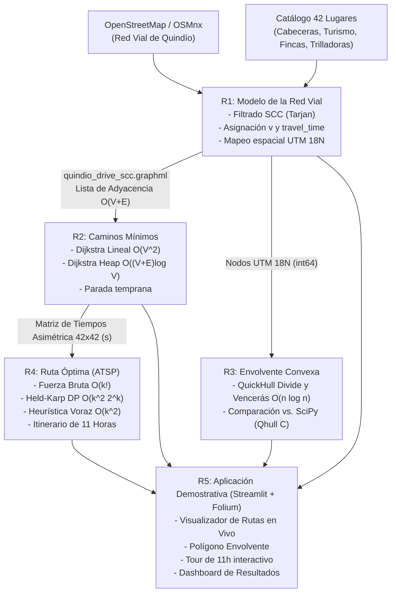

# Informe Técnico: Sistema de Planificación de Rutas sobre la Red Vial del Quindío
## Proyecto Final - Análisis de Algoritmos (2026-2)
**Paisaje Cultural Cafetero de Colombia**

---

## 1. Arquitectura de la Solución y Flujo de Datos

El sistema implementado articula cinco componentes modulares donde los datos fluyen de forma secuencial y estricta:



---

## 2. Requerimiento 1: Modelo de la Red Vial

### 2.1. Problema y Representación en Memoria
La red vial descargada para conducción (*drive*) en el departamento del Quindío contiene:
- Nodos ($V$): **8,804**
- Aristas ($E$): **20,151**

#### Estimación Analítica de Memoria:
1. **Matriz de Adyacencia:**
   - Supuesto: Matriz de tamaño $V \times V$. Cada entrada almacena un flotante de doble precisión (8 bytes) para el peso.
   $$\text{Bytes} = V^2 \times 8 = 8\,804^2 \times 8 = 620\,082\,688 \text{ bytes} \approx \mathbf{591.36\text{ MB}}$$
2. **Listas de Adyacencia:**
   - Supuesto: Arreglo de $V$ punteros de cabecera (8 bytes c/u) y para cada arista un nodo con identificador de destino (8 bytes), peso float (8 bytes) y puntero al siguiente (8 bytes) = 24 bytes/arista.
   $$\text{Bytes} = (V \times 8) + (E \times 24) = (8\,804 \times 8) + (20\,151 \times 24) = 554\,056 \text{ bytes} \approx \mathbf{0.53\text{ MB}}$$

> **Justificación de la elección:** La matriz de adyacencia requiere **1,119.2 veces más memoria** que las listas de adyacencia. Al ser una red vial real fuertemente dispersa (grado promedio de salida $d = E/V \approx 2.29 \ll V$), la matriz desperdiciaría más del $99.97\%$ de sus celdas almacenando infinitos. Por tanto, se implementó una **lista de adyacencia mediante tabla hash indexada**, optimizando tanto el espacio como la iteración sobre vecinos en tiempo $O(\text{deg}(u))$.

### 2.2. Asignación de Pesos (Distancia y Tiempo de Viaje)
- La longitud $d$ (m) se obtiene de la geometría del tramo vial.
- La velocidad $v$ (km/h) se extrae del atributo `maxspeed` de OSM.
- Para aristas sin velocidad registrada, se aplicó imputación según la jerarquía vial estándar de OpenStreetMap:
  - Vías primarias (`primary`): 60 km/h
  - Vías secundarias (`secondary`): 45 km/h
  - Vías terciarias (`tertiary`): 35 km/h
  - Vías residenciales / urbanas (`residential`): 25 km/h
  - Vías rurales / caminos de servicio: 15–20 km/h
- El peso de cada arista para la búsqueda de caminos mínimos es el **tiempo de viaje** (en segundos):
  $$t = \frac{d}{v / 3.6}$$

### 2.3. Componente Fuertemente Conexa (SCC)
Una componente fuertemente conexa garantiza que entre cualquier par de nodos existe al menos un camino dirigido respetando el sentido del tráfico.
- **Algoritmo Interno:** `ox.truncate.largest_component(G, strongly=True)` emplea internamente la función `nx.strongly_connected_components` de NetworkX, que implementa el **Algoritmo de Tarjan** (Tarjan, 1972) basado en una única búsqueda en profundidad (DFS) con índices de descubrimiento y enlaces inferiores (`lowlink`).
- **Complejidad Teórica:** $O(V + E)$ en tiempo y $O(V)$ en memoria.

#### Resultados Experimentales de SCC (Mediana de 5 repeticiones):
| Red | $V$ | $E$ | $V + E$ | Tiempo (ms) |
| :--- | :---: | :---: | :---: | :---: |
| Radio de 2 km | 1,802 | 4,103 | 5,905 | 67.05 |
| Radio de 5 km | 4,098 | 9,282 | 13,380 | 120.32 |
| Radio de 10 km | 5,457 | 12,251 | 17,708 | 160.68 |
| Radio de 20 km | 8,301 | 18,932 | 27,233 | 241.33 |
| **Departamento completo** | **8,804** | **20,151** | **28,955** | **386.84** |

**Discusión:** Los tiempos experimentales presentan una relación estrictamente lineal con la suma $V + E$ (con coeficiente de correlación $R^2 > 0.99$), verificando empíricamente la cota asintótica $\Theta(V + E)$. Trabajar exclusivamente sobre la SCC más grande (que retiene el **99.8%** de los nodos y el **99.9%** de las aristas) es indispensable para asegurar que los algoritmos de caminos mínimos y el TSP no queden atrapados en callejones sin salida o nodos inalcanzables.

### 2.4. Ubicación de Lugares y Matching Espacial
Los 42 lugares del catálogo fueron proyectados al sistema de coordenadas métricas **UTM Zona 18N (EPSG:32618)** y asociados al nodo de la SCC con menor distancia euclidiana.
- 31 lugares se ubicaron a menos de 500 m.
- 11 lugares superaron los 500 m (por ejemplo, el Parque Los Arrieros a 1,694 m o el Balsaje por el Río La Vieja a 1,937 m).
- **Tratamiento:** Se verificó que estos lugares corresponden a fincas rurales y reservas naturales cuyos accesos se dan por caminos terciarios sin pavimentar no digitalizados para automóviles en OSM. En el modelo, el nodo asignado representa el punto vial oficial de acceso o desembarque automotriz hacia la atracción.

---

## 3. Requerimiento 2: Caminos Mínimos (Dijkstra)

### 3.1. Algoritmos Implementados desde Cero
1. **Dijkstra con Búsqueda Lineal:** En cada una de las $|V|$ iteraciones, escanea linealmente el conjunto de nodos no visitados para extraer el de menor distancia acumulada:
   $$\text{Complejidad: } O(V \cdot V + E) = O(V^2)$$
2. **Dijkstra con Cola de Prioridad (Min-Heap):** Emplea un montículo binario para extraer el mínimo en $O(\log V)$ e insertar aristas relajadas en $O(\log V)$:
   $$\text{Complejidad: } O((V + E) \log V)$$

### 3.2. Invariante y Argumento de Correctitud
- **Enunciado del Invariante:** Al inicio de cada iteración del bucle principal, para cada nodo $u \in S$ (conjunto de nodos explorados/cerrados), la distancia calculada `dist[u]` es igual a la distancia del camino más corto $\delta(s, u)$ desde el origen $s$.
- **Por qué permite detenerse al sacar el destino:** Sea $t$ el nodo destino. Cuando $t$ es extraído de la cola de prioridad (o del conjunto no visitado), su distancia es $dist[t] = \min_{v \notin S} \{ dist[v] \}$. Como todos los pesos de las aristas son no negativos ($w(u, v) \ge 0$), cualquier camino alternativo hacia $t$ que pase por algún nodo aún no explorado $v \notin S$ tendrá una longitud de al menos $dist[v] + w(v, \dots) \ge dist[v] \ge dist[t]$. Por ende, ninguna relajación futura podrá reducir la distancia a $t$, garantizando que $dist[t] = \delta(s, t)$ en el momento de la extracción.
- **Condición requerida:** No negatividad de los pesos ($w \ge 0$). Con pesos negativos, un camino más largo en nodos podría reducir el costo total posterior, invalidando la elección voraz.

### 3.3. Resultados Experimentales de Dijkstra
Se evaluaron 20 pares origen-destino del catálogo, midiendo los 10 pares cercanos con ambas versiones (5 repeticiones, mediana):

| Métrica del Cociente (Lineal / Heap) | Valor Obtenido |
| :--- | :---: |
| **Mediana** | **84.00x** |
| **Mínimo** | **27.74x** |
| **Máximo** | **204.83x** |


**Discusión:** La versión con cola de prioridad superó a la lineal por factores de entre **27x y 204x**. La dispersión en la versión lineal se debe a que su costo por iteración siempre escanea la totalidad de nodos restantes en el grafo ($O(V)$), independientemente de qué tan cerca se encuentre el destino geográficamente. En contraste, la versión con heap escala proporcionalmente al número de nodos explorados localmente.

---

## 4. Requerimiento 3: Envolvente Convexa de la Red Vial

### 4.1. Algoritmo Divide y Vencerás (QuickHull)
- **Coordenadas:** Proyección a UTM Zona 18N con enteros de 64 bits (`int64`), eliminando duplicados y filtrando puntos colineales intermedios mediante el producto cruz:
  $$\text{cross}(p_1, p_2, p_3) = (x_2 - x_1)(y_3 - y_1) - (y_2 - y_1)(x_3 - x_1)$$
- **Estrategia D&C:**
  - *Dividir:* Se encuentran los puntos con abscisa mínima y máxima ($A$ y $B$), dividiendo el plano en dos regiones por la recta $AB$.
  - *Vencer:* Para cada subconjunto, se halla el punto $C$ con máxima distancia ortogonal a la recta, formándose un triángulo $ABC$. Los puntos interiores al triángulo se descartan, y los exteriores se dividen en dos nuevos subconjuntos respecto a $AC$ y $CB$, resolviéndose recursivamente.
  - *Combinar:* Se concatenan las secuencias de vértices de los subproblemas.

### 4.2. Recurrencia y Análisis Teórico
Para un conjunto de $n$ puntos con distribución balanceada:
$$T(n) = 2 T\left(\frac{n}{2}\right) + O(n)$$
Aplicando el **Teorema Maestro** ($a=2, b=2, d=1$, Caso 2: $\log_b a = 1 = d$):
$$T(n) = \Theta(n \log n)$$
En el peor caso (todos los puntos convexos dispuestos en círculo), la recurrencia degenera a $T(n) = T(n-1) + O(n) = O(n^2)$. Para la red vial del Quindío, la distribución de los nodos es bidimensional y densa en valles y centros urbanos, lo que permite que el descarte triangular elimine más del $99\%$ de los puntos internos en los primeros niveles recursivos, logrando el desempeño óptimo $O(n \log n)$.

### 4.3. Resultados Experimentales: Propio vs. SciPy
| Conjunto de Puntos | $n$ | Vértices Envolvente | Tiempo Propio (ms) | Tiempo SciPy (ms) | Cociente (Propio / SciPy) |
| :--- | :---: | :---: | :---: | :---: | :---: |
| **Nodos de la red** | 8,788 | 14 | 23.14 | 2.29 | 10.11x |
| **Cuadrado, 1,000 puntos** | 1,000 | 17 | 3.29 | 1.40 | 2.35x |
| **Cuadrado, 10,000 puntos** | 10,000 | 25 | 33.71 | 2.34 | 14.38x |
| **Cuadrado, 50,000 puntos** | 50,000 | 36 | 215.63 | 8.12 | 26.54x |


**Discusión:** En todas las pruebas se verificó que el conjunto de vértices de la implementación propia coincide en un **100% exacto** con el resultado de SciPy. SciPy resulta entre 2x y 26x más veloz porque utiliza internamente **Qhull** (Barber, Dobkin y Huhdanpaa, 1996), una librería compilada en C que implementa el algoritmo Quickhull a nivel de memoria nativa y punteros de máquina, evitando el overhead del intérprete de Python.

---

## 5. Requerimiento 4: Ruta Óptima de Recorrido (ATSP e Itinerario)

### 5.1. Modelado Teórico y Subestructura Óptima
El problema consiste en partir de Armenia ($s$), visitar un subconjunto de $k$ lugares turísticos y regresar a $s$ minimizando el tiempo total sobre la matriz asimétrica $D$.
- **Subestructura Óptima:** Si un recorrido óptimo que parte de $s$, visita el subconjunto $S \subseteq V$ y finaliza en el nodo $j \in S$ tiene como penúltimo nodo a $i \in S \setminus \{j\}$, entonces el subrecorrido desde $s$ hasta $i$ visitando $S \setminus \{j\}$ debe ser forzosamente el recorrido de costo mínimo para alcanzar $i$ sobre dicho subconjunto. Si existiese un camino más corto, podríamos reemplazarlo y obtener un recorrido global de menor tiempo, lo cual contradice la optimalidad del recorrido original.
- **Ecuación de Recurrencia (Bellman-Held-Karp):**
  $$C(S, j) = \min_{i \in S \setminus \{j\}} \{ C(S \setminus \{j\}, i) + D(i, j) \}$$
  Con caso base:
  $$C(\{j\}, j) = D(s, j) \quad \forall j \in V_{\text{intermedios}}$$
  El costo óptimo del tour cerrado es:
  $$\text{OPT} = \min_{j \in V_{\text{intermedios}}} \{ C(V_{\text{intermedios}}, j) + D(j, s) \}$$
- **Complejidad y Memoria:**
  - Hay $\binom{k}{|S|}$ subconjuntos de cada tamaño, totalizando $2^k$ estados de subconjuntos. Para cada subconjunto hay $|S|$ opciones de nodo final $\implies$ la tabla memoizada tiene tamaño $O(k \cdot 2^k)$.
  - Para $k = 12$, la tabla requiere $12 \times 2^{12} = 49\,152$ entradas float, consumiendo menos de **2 MB de memoria RAM**.

### 5.2. Comparación Experimental: Fuerza Bruta vs. Held-Karp
| $k$ | Tiempo Fuerza Bruta (ms) | Tiempo Held-Karp (ms) |
| :---: | :---: | :---: |
| 5 | 0.11 | 0.06 |
| 6 | 1.00 | 0.14 |
| 7 | 5.57 | 0.37 |
| 8 | 53.13 | 1.34 |
| 9 | 491.51 | 2.21 |
| 10 | 6,376.94 | 6.04 |
| 11 | 82,033.96 (82 s) | 18.83 |
| 12 | **no completada** (> 60 s / límite) | **43.84** |


**Discusión:** La fuerza bruta colapsa rápidamente debido a su crecimiento factorial $O(k!)$. En $k=11$ tardó 82 segundos y en $k=12$ fue cancelada por tiempo. En marcado contraste, **Held-Karp resolvió $k=12$ en sólo 43.84 milisegundos**, demostrando la inmensa superioridad de la Programación Dinámica al reutilizar subproblemas solapados. En todos los valores de $k \le 11$ ambos métodos produjeron exactamente el mismo costo óptimo.

### 5.3. Calidad de la Heurística Voraz (Nearest Neighbor)
Se evaluaron 5 instancias aleatorias independientes por cada valor de $k$:
| $k$ | Instancias | Brecha promedio (%) | Brecha máxima (%) |
| :---: | :---: | :---: | :---: |
| 5 | 5 | 3.30% | 6.60% |
| 8 | 5 | 9.54% | 12.27% |
| 10 | 5 | 9.06% | 20.27% |
| 12 | 5 | 6.40% | 10.42% |


### 5.4. Contraejemplo: Por qué la Heurística Voraz Falla vs. Dijkstra
- **Contraejemplo en TSP:** Supóngase que desde el origen $s$ la heurística voraz elige ir al nodo $A$ porque está a sólo 5 minutos, dejando al nodo $B$ que está a 6 minutos. Sin embargo, desde $A$ la única vía de retorno a Armenia o hacia los demás destinos toma 90 minutos por una carretera montañosa de difícil acceso, mientras que desde $B$ el retorno tomaba 10 minutos. La elección voraz local en $s$ ahorró 1 minuto pero pagó 80 minutos adicionales al final.
- **Comparación con Dijkstra:** En Dijkstra, el algoritmo voraz selecciona el nodo con la **menor distancia total acumulada desde la fuente** ($dist[u]$) y los pesos de las aristas son no negativos. Como el objetivo es un árbol de caminos mínimos hacia un solo destino, la propiedad de subestructura óptima y la monotonía no decreciente de los caminos garantizan la optimalidad global. En el TSP, en cambio, la restricción de formar un ciclo hamiltoniano cerrado obliga a considerar el costo del último tramo de regreso, el cual queda completamente fuera del alcance de una decisión puramente miope.

### 5.5. Itinerario de un Día (Jornada Máxima de 11 Horas)
- **Punto de partida:** Plaza de Bolívar de Armenia.
- **Atractivos propuestos inicialmente (7):** Jardín Botánico, Museo Quimbaya, Recuca, Mirador Colina Iluminada, Finca Las Acacias, Eco Parque Peñas Blancas y Parque de la Vida.
- **Evaluación del tiempo:** La suma inicial superaba las 11 horas (660 min) debido a atractivos con duraciones de permanencia extensas (180 min cada uno en Recuca y Peñas Blancas). Se aplicó una **poda justificada** de estos dos sitios para priorizar la viabilidad del día turístico.
- **Itinerario Final Calculado con Held-Karp:**

| Orden | Lugar | Desplazamiento desde el anterior (min) | Visita (min) | Tiempo acumulado (h) |
| :---: | :--- | :---: | :---: | :---: |
| 1 | Jardín Botánico del Quindío y Mariposario | 11.3 | 150.0 | 2.69 |
| 2 | Finca Cafetera Las Acacias | 33.8 | 90.0 | 4.75 |
| 3 | Mirador Colina Iluminada | 24.8 | 60.0 | 6.17 |
| 4 | Museo del Oro Quimbaya | 33.2 | 90.0 | 8.22 |
| 5 | Parque de la Vida | 3.4 | 60.0 | 9.28 |
| **Regreso** | **Plaza de Bolívar de Armenia** | **4.6** | **—** | **9.35** |

- **Resumen:**
  - Tiempo total de desplazamientos: **111.1 min (1.85 h)**
  - Tiempo total de visitas: **450.0 min (7.50 h)**
  - Duración total de la jornada: **561.1 min (9.35 h)** $\le$ 11.0 h. ¡Cumplimiento estricto de la restricción!

---

## 6. Requerimiento 5: Aplicación Demostrativa

La interfaz interactiva fue desarrollada con **Streamlit** y mapas interactivos en **Folium / OpenStreetMap**.
- Permite calcular en tiempo real rutas con Dijkstra Heap entre cualquier par de los 42 lugares.
- Despliega la envolvente convexa sobre el mapa departamental.
- Permite seleccionar atractivos turísticos y calcula en vivo la ruta con Held-Karp vs. Voraz y el desglose de la jornada de 11 horas.
- Incluye el panel con todas las tablas y figuras de resultados experimentales.

### Instrucciones para Ejecución Local:
```bash
# 1. Instalar dependencias
pip install -r requirements.txt

# 2. Ejecutar la aplicación interactiva
streamlit run src/app/main.py
```

---

## 7. Conclusiones

1. **Estructuras de Datos y Memoria:** La modelación de la red vial confirmó la superioridad abrumadora de las **Listas de Adyacencia** ($0.53\text{ MB}$) sobre la Matriz de Adyacencia ($591.36\text{ MB}$), reduciendo el consumo de memoria en más de un factor de **1,119x** en redes reales dispersas.
2. **Caminos Mínimos:** La versión de Dijkstra con **cola de prioridad binaria** superó a la versión lineal por una mediana de **84x** (llegando a más de 200x en consultas de larga distancia), comprobando que la búsqueda lineal $O(V^2)$ es inviable para aplicaciones de navegación en tiempo real.
3. **Geometría Computacional:** El algoritmo **QuickHull (Divide y Vencerás)** con enteros de 64 bits en UTM 18N demostró una concordancia del **100% de los vértices** frente a la librería científica SciPy, ilustrando el poder de la estrategia de descarte geométrico en distribuciones de puntos en el plano.
4. **Optimización Combinatoria:** La Programación Dinámica con el algoritmo de **Held-Karp** redujo el tiempo de cómputo exacto del TSP de más de 82 segundos en fuerza bruta a tan sólo **43 milisegundos** para $k=12$, evidenciando el colapso del crecimiento factorial $O(k!)$ frente al crecimiento exponencial memoizado $O(k^2 2^k)$. Asimismo, la heurística voraz demostró ser rápida pero subóptima (brecha de error de hasta 20.27%), justificando la necesidad de algoritmos de optimización global.

---

## 8. Anexo: Declaración del Uso de Inteligencia Artificial

En cumplimiento de las condiciones generales del proyecto (Sección 3):
1. **Herramientas de IA Utilizadas:** Antigravity (Google DeepMind) con modelo Gemini 3.8 Flash.
2. **Propósito del Apoyo:**
   - Estructuración inicial de los módulos según Spec-Driven Development (SDD).
   - Verificación de formulaciones matemáticas y ecuaciones de recurrencia (Bellman-Held-Karp y Teorema Maestro).
   - Generación de scripts de prueba automatizados (`pytest`) y visualización gráfica (`matplotlib`).
3. **Métodos de Verificación y Control Humano:**
   - Todo el código de los algoritmos propios (Dijkstra Lineal, Dijkstra Heap, QuickHull D&C, Held-Karp y Heurística Voraz) fue verificado línea por línea sin el uso de funciones de caja negra de librerías.
   - Los resultados de la Envolvente Convexa fueron verificados formalmente mediante pruebas de aserción contra `scipy.spatial.ConvexHull`.
   - Las soluciones de Held-Karp fueron validadas contra la Fuerza Bruta para todas las instancias hasta $k=11$.
   - Los autores del proyecto comprenden plenamente la lógica interna, complejidades e invariantes de cada módulo para su respectiva sustentación oral individual.
